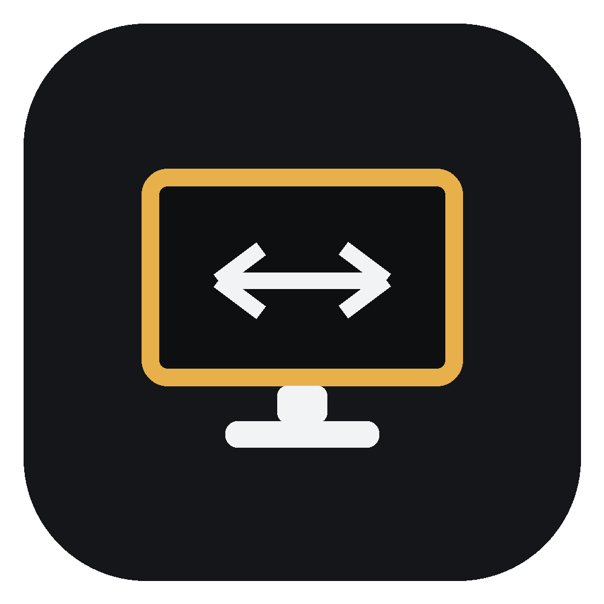

# ResChanger

<p align="center">
  
</p>

<p align="center">
  <b>Portable display resolution and refresh rate switcher for Windows 10/11 x64.</b><br>
  Switch display resolution and refresh rate from anywhere with global hotkeys.
</p>

<p align="center">
  
  
  
  
</p>

**English** | [Русский](README.ru.md)

ResChanger is a portable Windows utility that switches display resolution and refresh rate with global hotkeys. It is built with WPF / .NET Framework 4.8.

This repository distributes the portable build and user documentation. Source code is maintained separately.

## Download

Get the latest version from [Releases](https://github.com/skretny/ResChanger/releases).

1. Download `ResChanger.exe`.
2. Run the executable. No installer or separate .NET runtime download is required on Windows 10/11.
3. Verify the SHA-256 checksum from `ResChanger.exe.sha256` if needed.
4. Enable **Start with Windows** in Settings if needed.

The executable is about 270 KB and uses the built-in .NET Framework 4.8. Settings are stored per user in `%LOCALAPPDATA%\ResChanger\settings.json`.

The build is not code-signed, so Windows SmartScreen may show a warning on first launch.

## Features

- Up to 9 resolution profiles.
- Target monitor per profile.
- If a monitor is disconnected, the profile keeps its binding and shows a warning. After the monitor reconnects, the profile is ready to use again.
- Resolution and refresh rate selection. **Auto** keeps the current or highest supported refresh rate.
- Global hotkeys that work while the window is hidden.
- In-app hotkey capture.
- Profiles in the tray menu.
- Restore the initial display modes captured at startup.
- Autostart, start minimized, close to tray, notifications, theme, and hotkeys.
- 11 languages: English, Беларуская, Čeština, Deutsch, Español, Français, हिन्दी, Italiano, Русский, Türkçe, Українська.
- System language and system theme by default.
- Single instance: launching the app again shows the running window.

## Hotkeys

| Action | Default combination |
|---|---|
| Show window | `Ctrl+Alt+R` |
| Restore initial resolution | `Ctrl+Alt+Shift+R` |
| Apply profile 1–9 | `Ctrl+Alt+1` … `Ctrl+Alt+9` |

All combinations can be changed in the interface. In the capture window, `Del` removes a hotkey; `Esc` cancels.

## Command line

```text
ResChanger.exe              normal launch
ResChanger.exe --minimized  start in the tray (used by autostart)
ResChanger.exe --show       force the window to show
```

## Configuration

```text
%LOCALAPPDATA%\ResChanger\settings.json
```

Unhandled errors are written to:

```text
%LOCALAPPDATA%\ResChanger\error.log
```

Use **Settings → Data → Open folder** to open the configuration directory.

## Troubleshooting

- **The image is lost after changing the mode.** Press `Ctrl+Alt+Shift+R` to restore the modes captured at startup. If that does not help, reboot into Safe Mode and change the resolution manually.
- **A hotkey is not registered.** Another application already uses the combination. Choose another one in Settings or in the profile row.
- **A profile says `Display not found.`** The target monitor is disconnected. Reconnect it or select another monitor in the profile.
- **The app is already running.** ResChanger is single-instance; the existing window is shown instead.

## Support

The **Support** button at the bottom left opens **Tribute (Telegram)** and **Donatex** links.

Report bugs and suggest features via [GitHub Issues](https://github.com/skretny/ResChanger/issues).

## License

MIT. Copyright (c) 2026 skretny. See [LICENSE](LICENSE).

See [CHANGELOG.md](CHANGELOG.md) for version history.

