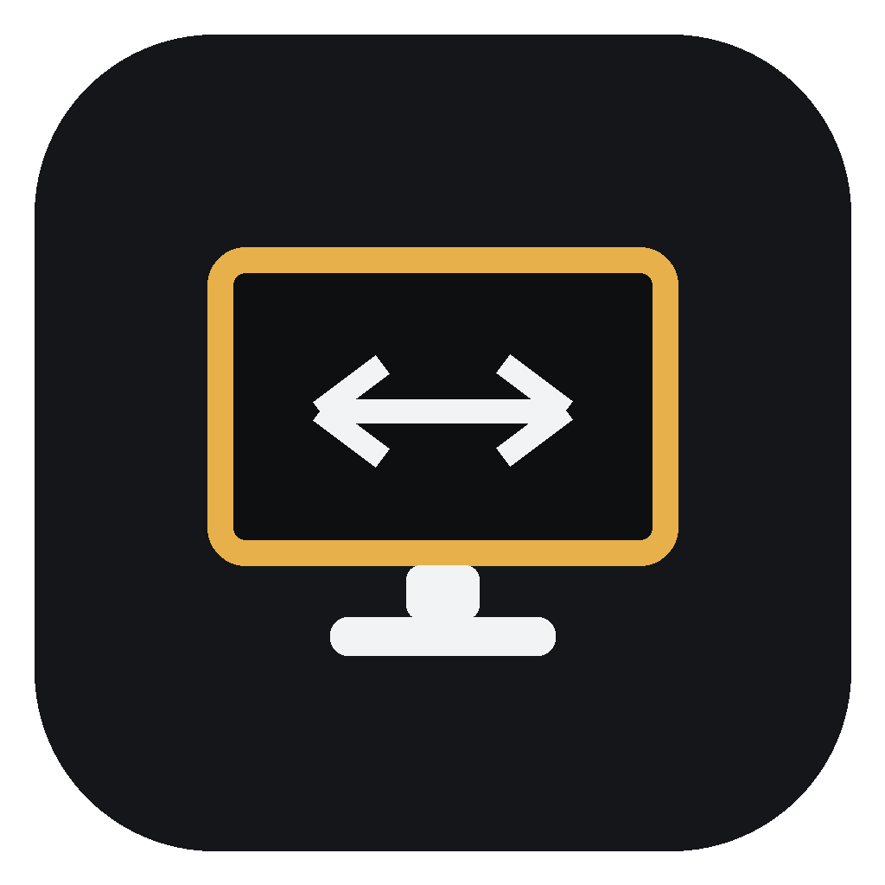

# ResChanger

  

  <b>Портативная смена разрешения и частоты обновления для Windows 10/11 x64.</b> 
  Меняйте разрешение и частоту обновления из любого приложения.

  
  
  
  

[English](README.md) | **Русский**

ResChanger — портативная утилита для Windows, которая меняет разрешение экрана и частоту обновления по глобальным горячим клавишам. Работает на WPF / .NET Framework 4.8.

## Решение проблем

- **Изображение пропало после смены режима.** Нажмите `Ctrl+Alt+Shift+R`, чтобы вернуть режимы, сохранённые при запуске. Если это не помогло, загрузитесь в безопасном режиме и смените разрешение вручную.
- **Горячая клавиша не регистрируется.** Сочетание уже занято другой программой. Выберите другое в настройках или в строке профиля.
- **Профиль показывает `Дисплей не найден.`** Целевой монитор отключён. Подключите его или выберите другой монитор в профиле.
- **Приложение уже запущено.** ResChanger работает в одном экземпляре; вместо нового окна показывается существующее.

## Поддержка

Кнопка **«Поддержать»** внизу слева открывает **Tribute (Telegram)** и **Donatex**.

Ошибки и предложения: [GitHub Issues](https://github.com/skretny/ResChanger/issues).

## Лицензия

MIT. Copyright (c) 2026 skretny. См. [LICENSE](LICENSE).

История версий: [CHANGELOG.md](CHANGELOG.md).

